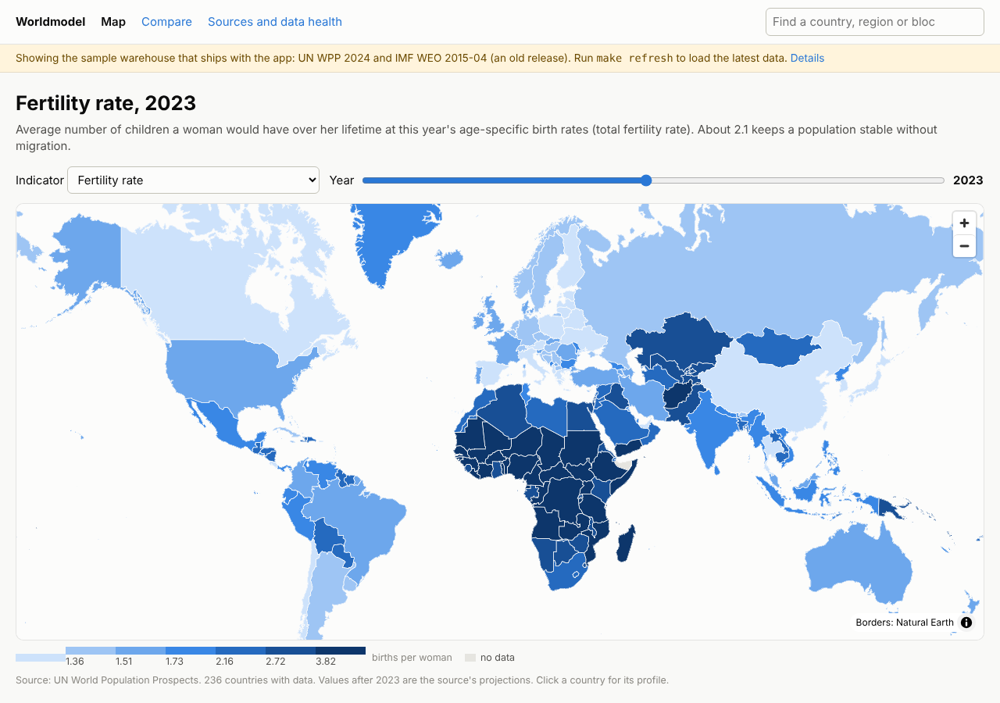

# worldmodel

A personal app for exploring, comparing, mapping and (later) forecasting data
about every country, region and bloc. Everything runs on your own machine.

This is **phase 0**: the foundations, with population (UN World Population
Prospects) and GDP growth (IMF World Economic Outlook) as the first data.



## How it fits together

```
 sources ──► data/ (worldmodel-data CLI) ──► var/warehouse/builds/*.duckdb ──► app/api (FastAPI) ──► app/web (Next.js)
               fetch, keep every vintage,       CURRENT points at the           read-only             map, profiles,
               build with dbt, validate,        live build                                          compare, data health
               swap in only if gates pass                                         ▲
                                                                                  └── other tools: /api/v1/streams, CSV/Parquet/JSON
                          contract/  ◄── both sides depend on this and on nothing of each other:
                                         schema + version, entity crosswalk, indicator catalogue,
                                         sources, named streams, driver graph
```

- **data/** fetches sources, stores each release unchanged as a dated vintage,
  builds the DuckDB warehouse with dbt, runs the validation gates, and only then
  points `var/warehouse/CURRENT` at the new build. Runs headless; no web app needed.
- **app/** is the local API and web app. It reads whichever warehouse it is
  pointed at, never writes to it, and checks the schema version on start. It
  ships with a sample warehouse (`app/sample/`), so it runs with no pipeline.
  The only files it writes are your own, in `var/user/`: saved layouts,
  settings, which indicators are switched on, and the history log.
- **contract/** is the only code both import. Besides the schema and
  catalogues it holds the shared view of the data folder: settings and their
  limits, disk use, and the refresh log (`worldmodel_contract.local`).

More in [docs/architecture.md](docs/architecture.md).

## Quick start

Needs Python 3.11+ and Node 20+.

```sh
make setup        # virtualenv + Python packages + npm install
make api          # terminal 1: API on http://127.0.0.1:8000 (docs at /docs)
make web          # terminal 2: app on http://localhost:3030
```

The app starts on the bundled sample. To load current data:

```sh
make refresh      # fetch every source (UN, IMF, World Bank, OWID), build, validate, go live
```

The API notices the new build on its next request; no restart needed.

### On Windows, with conda

Needs [Miniconda or Anaconda](https://docs.conda.io/en/latest/miniconda.html)
and Git. The scripts find conda themselves, so any terminal works: PowerShell,
Command Prompt or an Anaconda Prompt. In PowerShell, type `.\setup.bat` and so on.

```bat
git clone https://github.com/Nichevo/worldmodel D:\worldmodel
cd D:\worldmodel
.\setup.bat       :: once: conda env "worldmodel" (Python, Node, Git) + all packages
.\start.bat       :: API and web app in their own windows, then the browser
.\refresh.bat     :: fetch the latest data, build, check, go live (the app can stay open)
```

Other PCs on your network can open the app at `http://<this PC's name or IP>:3030`
(start.bat prints the address). Only the web app is reached from outside: it passes
data requests on to the API, which stays on this PC alone. If the other PC can't
connect at all, allow `node.exe` (port 3030) through Windows Firewall for private
networks. If you open it under a name the app doesn't recognise, the page shows
but stays empty; add that name to `WORLDMODEL_ALLOWED_HOSTS` (comma separated).

If conda is installed somewhere unusual and the scripts can't find it, run them
from an Anaconda Prompt instead.

Your data lives in `var\` inside this folder (set as `WORLDMODEL_HOME` in the
conda environment, so it doesn't depend on where you run commands from). To
load current data, run `.\refresh.bat`. Each refresh is logged; the Data status
page charts the space used, the rows changed and how each run went, and warns
when the folder nears the size limit set in Settings.

### Updating

Stop the app (close its two windows), then:

```bat
.\update.bat       :: Windows: latest code from GitHub + any new packages
```
```sh
make update       # macOS / Linux
```

Updates only touch code and packages; `var/` (your downloads and builds) is
never changed. If an update says `environment.yml` changed, run `setup.bat` again.

### Files you download yourself

Some sites need a sign-in (EM-DAT) or turn programs away (RBNZ, MBIE, sometimes
IDEA, the US Census Bureau and uky.edu). Their files go in `var\manual\`, one folder
per source; `update.bat` makes the folders, each with a note saying where to get the
file. Save the file in its folder, keeping the name the site gives it, then run:

```bat
.\load.bat              :: load every folder that has a new file, then build
.\load.bat rbnz         :: load one folder
.\load.bat emdat D:\Downloads\emdat.xlsx   :: a file from elsewhere: copied into var\manual\emdat first
```

`.\refresh.bat` reads these folders too: sources that are only loaded by hand are loaded
from their folder, and when a download is refused, the file in that source's folder is
used instead. Loading the same file again changes nothing. For sources that load one file
at a time, older files move to the folder's `old` folder; nothing is deleted.

### Sources read from web pages

A few sources have no file or API, so the app reads their web pages: World Prison Brief,
CrisisWatch, UN vetoes, WTO disputes, UN treaties, NZ Corrections and the Electoral
Commission. Refresh reads them on their own schedule; `.\scrape.bat` reads them now, one
site after another, then builds:

```bat
.\scrape.bat                 :: every scraping source
.\scrape.bat prisons         :: World Prison Brief only (the first run goes back to 2000)
.\scrape.bat prisons 1995    :: back to 1995
.\scrape.bat crisiswatch wto :: any of: crisiswatch vetoes wto treaties corrections elections
```

Pages are read politely: at least the gap in Settings (6 s), longer on long runs, with a
rest every 10 pages, and each site stops at its first refused or odd-looking page. Data
status lists these sources and how each one's last run went.

## The data side

```sh
worldmodel-data fetch un_wpp                  # download a source, store a new vintage
worldmodel-data fetch imf_weo --from DIR      # or load files you downloaded yourself
worldmodel-data build                         # build + validate + swap in
worldmodel-data refresh                       # fetch every source, then build; logged for Data status
worldmodel-data status                        # vintages, live build, latest report, disk use
worldmodel-data free-space                    # delete old raw downloads (keeps 2 per source)
worldmodel-data validate                      # catalogue checks + gates on the live build
worldmodel-data keys                          # API key register: which keys are set (also on Data status)
worldmodel-data scan                          # relationship scan on the live build (also run after each refresh)
worldmodel-data export nz-population --format csv
```

Data lives in `./var` (set `WORLDMODEL_HOME` to move it). Back that folder up:
stored vintages are the one thing you cannot download again.

**Validation gates.** A build is swapped in only if every gate passes: dbt
tests (unique keys, every code in the crosswalk, values inside each
indicator's bounds, country populations add up to the UN world total, age
groups add up to the total), at least 200 countries for the core population
indicators and 180 for GDP growth, spot checks against published values, and
no series losing more than 10 percent of its rows. Each build writes a report
to `var/warehouse/reports/` with a random sample of values and links to check
by eye on the source sites. A failed build is kept as `*.failed.duckdb` and
the app keeps reading the previous one.

**Vintages.** Every fetch keeps the source files as downloaded under
`var/raw/`, plus a normalised Parquet copy under `var/vintages/`. A re-fetch
with identical content is skipped; a revised release becomes a new vintage
(`2024+20261105`). The API can answer "as known on a date" from these
(`as_of=` on `/series` and `/streams`).

## Data in this phase

| Source | What | Notes |
| --- | --- | --- |
| UN World Population Prospects 2024 | Population, growth, births, deaths, fertility, mean age at childbearing, sex ratio at birth, life expectancy, median age, migration, population by age and sex (pyramids), age shares, dependency ratio | Estimates to 2023, medium-variant projections to 2100; the low and high variants and the 80% and 95% prediction intervals as variants `low`, `high`, `lower80` .. `upper95` (from the optional "other variants" file) |
| IMF World Economic Outlook | Real GDP growth, GDP in US dollars and PPP, GDP per person, inflation, general government gross debt | Latest release from the DataMapper API; projections about five years ahead |
| IMF WEO historical forecasts | What every WEO since 1990 forecast for GDP growth and inflation | One Excel file, linked from the WEO page of the IMF Data Portal; each release kept as breakdown `release=YYYY-MM`, for the track record |
| World Bank World Development Indicators | Every WDI series (about 1,500): economy, prices and price levels, trade, government, military spending (SIPRI), labour, poverty, health, education, environment and more; income groups | One bulk zip (if the World Bank's download server refuses it, the main series come from its Indicators API instead, and the rest wait for the next refresh). About 120 main series start switched on under plain ids (`unemployment`, `military_spending_gdp`, `price_level_ratio`); the rest are `wdi_<code>`, switched off until you switch them on on the Indicators page. Series the catalogue already has (population, GDP, inflation) become a second source for the comparison |
| Our World in Data energy dataset | Electricity by source (Ember), primary energy, production and consumption of oil, gas and coal (Energy Institute, EIA), carbon intensity | One CSV from OWID's GitHub. Shares and per-person figures for continents and blocs are recomputed from the amounts |
| Our World in Data charts | Deaths in armed conflicts (UCDP), by the country where they occurred | One chart download each; a chart OWID has removed only warns |
| CIA World Factbook, 1990 to 2025 | Every field of every edition as text (geography, people, government, economy, energy, military and more), plus about 60 numbers from it: GDP (PPP), public debt, oil and gas reserves and production, electricity, airports, railways, roads, coastline and the like, and a third source for population, fertility, life expectancy, growth and inflation | One SQLite file (694 MB, downloaded once) from the CIA World Factbooks Archive on GitHub. The CIA has stopped the Factbook, so this is frozen: a refresh never fetches it again. Former states (Soviet Union, Czechoslovakia, Yugoslavia, both Yemens, East Germany) are kept as their own entities. Numbers come from each edition's text, dated by the year the edition gives for them |
| Wikidata | A facts box for each country: official name, capital, heads of state and government, government type, languages, currency, memberships, calling code and more; the names of its Wikipedia article, flag, coat of arms and locator map. Events: national elections and referendums since 1945, heads of state and government with their terms, major sporting events (Olympics, Paralympics, football, rugby and cricket World Cups, Commonwealth, Asian and Pan American Games and more) with host countries and dates, and named disasters | One query a month to the Wikidata Query Service for the facts, and one each for elections, leaders, sporting events and disasters (a refresh skips them in between; one that times out is skipped until next month) |
| Powell and Thyne coups | Every coup attempt since 1950, successful or failed, to the day | One text file from the University of Kentucky, checked monthly |
| UCDP/PRIO Armed Conflict Dataset | Armed conflicts since 1946 with at least 25 battle deaths a year: who fought, the type (interstate, intrastate, internationalised) and intensity (minor, or war at 1,000+ deaths a year), as episodes from their start date to their end | One zip from UCDP, checked monthly; each country in the conflict's location gets the event |
| EM-DAT | Disasters since 1900 (earthquakes, storms, floods, droughts, wildfires, epidemics...) with deaths, people affected and damage in today's dollars | Needs a free sign-in at public.emdat.be, so a refresh never fetches it: download the table there and load it with `.\load.bat emdat <file.xlsx>` (once a year is plenty) |
| BIS | Residential property prices, nominal and after inflation (index 2010 = 100), and household debt as % of GDP | The BIS statistics API (CSV); if it cannot be reached, the property prices come from the copy on GitHub (datasets/house-prices-global). Quarters averaged to years |
| OECD | House prices, rents, the price-to-rent and price-to-income ratios and both against their long-run average; household debt as % of disposable income | The OECD Data Explorer API (CSV), yearly |
| Dallas Fed International House Price Database | House prices and disposable income per person, nominal and real, for about 25 countries since 1975; the price-to-income ratio worked out from them | One Excel file, found on the database's page; checked every four weeks |
| IMF Global Debt Database | Household and company debt as % of GDP | DataMapper API |
| UN International Migrant Stock | People living in each country who were born abroad, people born in each country living abroad, and both by country of birth (`migrant_stock_by_origin`, breakdown `origin=<country>`) | One Excel file, found on the UN's page (2024 edition: 1990 to 2024) |
| UNHCR Refugee Data Finder | Refugees and asylum seekers hosted and fled, people displaced inside their country, stateless people, refugees by country of origin | The UNHCR API, every origin against every host, about 15 pages a second apart; monthly |
| Wittgenstein Centre Human Capital Data Explorer | Mean years of schooling of adults (all, women, men) from 1950 with projections to 2100, and shares by highest level of education | Two R data files (version 3, middle-of-the-road scenario) from IIASA, or the copy on GitHub; fetched once |
| UNDP Human Development Report | Human Development Index, expected and mean years of schooling, the gender and inequality-adjusted indices | One CSV, found on UNDP's downloads page |
| International IDEA Voter Turnout Database | Turnout at parliamentary and presidential elections, of registered voters and of the voting-age population; registered voters and votes cast | IDEA's export, asked for once per refresh. If IDEA answers with a web page instead, export the World table from idea.int and load it with `.\load.bat idea_turnout <file>` |
| OECD Economic Outlook | GDP growth and consumer price inflation, estimates and forecasts two years ahead, as further sources of `gdp_growth` and `inflation` | OECD Data Explorer SDMX API; each edition (June, December) stored as its own vintage for the track record; checked every two weeks |
| World Bank Global Economic Prospects | GDP growth, estimates and forecasts, as a further source of `gdp_growth` | World Bank API (source 27); each edition (January, June) stored as its own vintage; checked every two weeks |
| Eurostat AI use in enterprises | Share of enterprises (10+ employees) using at least one AI technology (`ai_use_enterprises`) | Eurostat SDMX-CSV of `isoc_eb_ai`; every four weeks |
| Anthropic Economic Index | Claude use per working-age person against the world average, and share of world use (`ai_claude_use_per_capita_index`, `ai_claude_use_share`) | The newest enriched Claude.ai file in the Hugging Face dataset `Anthropic/EconomicIndex`; every four weeks |
| Microsoft AI Diffusion Report | Share of working-age people using AI (`ai_use_population`), each year's latest half-year or quarter | From github.com/microsoft/ai-diffusion-report every four weeks |
| BIS policy rates and exchange rates | Central bank policy rates (yearly average and December), and each currency's US dollar rate | BIS statistics API (`WS_CBPOL`, `WS_XRU`) |
| US Census Bureau voting tables | Who voted and who registered at every November election since 1964: by age group, by sex (also within age groups), and for White non-Hispanic, Black, Asian and Hispanic Americans; citizens and all residents | Table A-1 (`hst_vote01.xlsx`), checked every three months. If the Census site refuses it, download it from the voting historical time series page and run `.\load.bat us_census_voting <file>` |
| Map layers | Tectonic plate boundaries (Bird 2003), active faults (GEM), volcanoes (Smithsonian GVP) and earthquakes of magnitude 6 and over since 1900 (USGS) | GeoJSON from GitHub, the Smithsonian's map service and the USGS event service; earthquakes weekly |
| Wikipedia | The introduction of each country's article, its main picture, flag and locator map, with credits | Never in a refresh. Fetched by the app through Wikipedia's official API when a country page is opened (and, if switched on in Settings, a few an hour in the background), within the daily limit in Settings, and kept for a month. Pictures stop at the pictures limit |

**Country pages** open with the Wikipedia introduction, pictures and the
Wikidata facts box, and end with the full **CIA World Factbook** entry: pick any
edition from 1990 to 2025, search the fields, and open a field's history to see
how its text changed across the editions. API: `/api/v1/entities/NZL/texts`
(`?edition=1995`, `?source=wikidata`), `/entities/NZL/texts/history?key=Coastline`,
`/entities/NZL/wikipedia`, `/wikipedia/status`.

**Income groups** (high, upper-middle, lower-middle and low income) are regions
like the continents: members are the World Bank's latest classification, and
their values are the World Bank's own where it publishes them, built from
members otherwise.

**Sources compared.** Where two sources publish the same figure (UN and World
Bank population, IMF and World Bank growth and inflation), the **Sources** page
draws them side by side for a country and lists the countries where they
differ most, in each country's latest common year: more than 5% apart, or for
percentages more than a point and 10%. Country pages list their own
disagreements, and each build reports them (`sources:divergence`). API:
`/api/v1/sources/indicators`, `/sources/compare?indicator=gdp_growth&entity=ARG`,
`/sources/divergence?indicator=gdp_growth&flagged=true`.

**Events and milestones.** Each country page has a **Timeline**: elections,
leaders, coups, conflicts, sporting events, disasters, a curated list of notable
episodes (the canal, railway, electrification, highway, telecom, shale and AI
build-outs in the US, Japan's asset bubble, the US housing bubble, China's
post-2008 investment push; each with its source, and more can be added to
`notable_episodes.csv`), your own milestones, and episodes worked out from the data at
every build: recessions (years of falling real GDP), growth, investment and
credit booms, inflation of 20% or more and government debt surges (the rules
and thresholds are in `contract/worldmodel_contract/catalogues/episode_rules.yaml`).
The same events show on the charts as shaded bands (anything that lasts) and
dotted lines (a single day), and the chart tooltip names those covering the
year under the pointer; Settings picks the kinds shown and the smallest
disaster. The **Events** page shows a year at a glance across countries, your
milestones, and **Around an event**: an indicator in the years before and
after every event of a kind (all Summer Olympics hosts, every successful coup,
every recession) with their average and the world over the same years, to see
what the events did. Milestones you add are kept in `var/user/milestones.json`.
API: `/api/v1/events?entities=JPN&kinds=sport,disaster&start=2000`,
`/events/kinds`, `/milestones`, `/around?indicator=gdp_growth&kind=sport&subkind=FIFA World Cup`.

**Governing party.** Leaders' terms from Wikidata carry their party and the
party's colour, so a one-country line chart can be coloured by the party in
government: the line and the area under it (or each bar) in the party's
colour, each leader's name where their term starts, the parties in the legend
and the government in the tooltip. Tick **Governing party** on a map-page
chart, or "Colour charts by governing party" on a country page; Settings
chooses the head of government (a prime minister) or of state (a president).

**Energy mix.** Country pages draw electricity generation and primary energy
by fuel as stacked areas, in TWh or as shares, from the OWID energy dataset.

**House prices and incomes.** Country pages set house prices against incomes,
both as an index on a common base year (choose it), nominal or after
inflation, so the gap between the lines shows how far homes have outrun pay.
"Price to income" shows the ratio against its own average, and "Household
debt" debt as a share of disposable income or of GDP. Prices come from the
Dallas Fed database where it covers the country, else the OECD or BIS; incomes
from the Dallas Fed, else the World Bank's income per person in local money.

**Migration in and out.** Country pages show people born abroad living there
against people born there living abroad, with the ten largest countries of
birth and of destination for any year, and the same for refugees.

**Education.** Country pages show adults' years of schooling, women and men,
from 1950 with the Wittgenstein Centre's projection to 2100, and the shares
by highest level of education.

**Map layers.** A map panel's **Layers** menu draws plate boundaries, active
faults, volcanoes (darker if they have erupted since 1900) and earthquakes of
magnitude 6 and over (sized by magnitude) over the countries. Hover one for its
name; the layers are saved with the panel and in pictures' credits.

**Your ratios.** On the Indicators page, **Make a ratio** divides one
indicator by another (times 100, 1,000 or any number): household debt by GDP,
military by education spending. A ratio is an indicator like any other, under
the topic "Your ratios", on maps, charts, tables, scatters and pictures,
worked out country by country and year by year from each part's first-ranked
source. Ratios are kept in `var/user/ratios.json`. API: `/api/v1/ratios`.

**Pictures.** Every saved picture (PNG) ends with a footer naming each dataset
in it in full, with its licence and the day it was saved. Country page charts
have a "Save picture" link too.

**The map page** holds up to six panels: one, two side by side or stacked,
one large and two small, three side by side, two by two, one large and four
small, or three by two.
**Hide controls** (or the F key) folds away the menus, banners and panel
toolbars so the panels fill the window; "Show controls", F or Esc brings them
back. The choice is remembered in the browser.

**Ranks.** A panel's **Ranks** view is a bump chart: how countries' ranks on
the panel's indicator change over the years (from a start year every few years,
years you pick, or every year in a span). Rank the selected countries, a group's
members or all countries (the selected ones in colour), among themselves or in
the whole world, highest or lowest first, with a top N (default in Settings).
It is saved with layouts; try the "G20 economies by size (ranks)" starter.

**Help notes.** A small **?** beside each country page card and each panel
explains what the chart shows, how it is worked out, its units and sources.

**Events on country page charts.** The chips at the top of a country page pick
which kinds of event show as bands on its charts; the choice is remembered, and
"As in Settings" goes back to the default set in Settings.

**Debt per person.** The country page's debt card stacks government, household
and company debt per person (US dollars or local currency) or as % of GDP.

## Forecasts

The **Forecasts** page (also linked from each country's profile) has three parts:

- **Population what-if.** Move fertility, life expectancy and migration away
  from the UN projection and see the total, the age pyramid and key shares
  change. The model (`contract/worldmodel_contract/cohort.py`) ages the
  population a year at a time by single year of age and sex, tuned each year to
  the UN's births and deaths. What you see is the UN projection plus the
  difference your changes make, so at the default settings it is the UN's
  exactly. Each build checks the model on its own against the UN projection and
  in a 30-year back-test (`whatif:` rows in the build report).
  Ready-made scenarios sit above the sliders: low and high fertility (the UN's
  variants, half a child fewer or more), fertility staying at today's level,
  no migration, double migration and longer lives.
- **Statistical forecast.** Any indicator for any country, extended past its
  last figure. Five simple models (last value, recent average change,
  straight-line trend, fading trend, back towards the long-run average) are
  each refitted on the figures up to each of the last dozen years and scored on
  how far they missed; the simplest within 5% of the best is used. The 80% and
  95% ranges are its own back-test misses at each distance, so a series that
  is hard to forecast gets wide bands. Levels that are always above zero
  (population, GDP) are modelled in percentage changes. The same forecast is a
  **Forecast** button on every chart on the country, indicator and topic pages,
  and a **Forecast** tick box on chart panels (saved with layouts). On a
  single-country chart it also draws each forecaster's own latest projections
  (IMF, OECD, World Bank). Settings → Forecasts sets how far ahead, which ranges
  and whether the forecasters are drawn.
- **Track record.** Past forecasts of GDP growth and inflation against what
  happened, for the IMF, the OECD Economic Outlook and the World Bank's Global
  Economic Prospects: typical miss and bias by how far ahead the forecast was,
  for each country and all countries together, and a **who forecasts best**
  table over the years every forecaster was scored, with the statistical
  forecast's own back-test alongside. The IMF's record goes back to 1990
  through its historical file; the OECD's and World Bank's build up from the
  second edition stored (each refresh after a new edition adds one).

API: `/api/v1/whatif?entity=NZL&tfr=-0.5&e0=2&mig=0.5&extra=0&phase=10&hold=false`,
`/api/v1/forecast?indicator=gdp_growth&entity=NZL&horizon=10`,
`/api/v1/track-record?indicator=gdp_growth&entity=NZL&source=oecd_eo` and
`/api/v1/track-record/compare?indicator=gdp_growth&entity=NZL`. The forecast
models are in `contract/worldmodel_contract/forecast.py`, so other tools reading
the data streams can use the same ones. `/series` and streams
take several variants (`variant=central,lower80,upper80`); the
`*-forecast` streams carry the UN ranges for forecasting tools.

Regions and blocs are entities with membership over time: the world, UN M49
continents and sub-regions, and EU, euro area, NATO, ASEAN, NAFTA/USMCA,
Mercosur, OPEC, G7, G20 and BRICS. A bloc's value for a year is built from the
members it had that year, with coverage shown. Bloc join and leave dates were
entered by hand and are marked `verified: no` in
`contract/worldmodel_contract/catalogues/memberships.csv` until checked
against the source linked on each row.

**The sample warehouse** holds real UN WPP 2024 data, a real but old IMF
release (April 2015), about 325 real World Bank series from a mirror, and the
main OWID energy series, a cut of the Factbook archive (every country's 2025
entry, all editions for a few countries, and all the Factbook numbers), BIS
house prices, the Wittgenstein Centre's schooling figures, UNHCR refugees, the
UN's 2020 migrant stock edition, plate boundaries, faults and volcanoes (all
from copies on GitHub), because
the build environment could not reach the UN, IMF or World Bank sites. It has no
Wikidata facts. Its income groups are worked out from GNI per person
rather than read from the World Bank. The app says so in a banner. See
[scripts/sample/README.md](scripts/sample/README.md).

## Topics and indicator pages

**Topics** (in the top bar) has a page for each subject: population, economy,
debt, prices, housing, energy, migration, education, health, military and AI
use. Each has a short introduction, a map, and the key countries (New Zealand,
Australia, the United States, the United Kingdom) against the world for every
indicator, each with the Forecast button. The topics and their indicators are
listed in `contract/worldmodel_contract/catalogues/topics.yaml`.

Every indicator has its own page (`/indicator/<id>`, linked from the
Indicators page and topic pages): what it measures, a map for any year, the
key countries against the world, every country ranked with its value ten years
before, and its sources with their licences.

**AI use by country** comes from three angles that cover different countries:
Eurostat's share of enterprises using AI (EU and nearby, yearly, fetched by
`refresh`), the Anthropic Economic Index's Claude use per person and share of
world use (fetched from its Hugging Face dataset by `refresh`), and Microsoft's
AI Diffusion Report share of working-age people using AI (fetched by `refresh`
from Microsoft's GitHub repository; each year shows its latest period).

**Voting** is a topic page too, and country pages for the US and New Zealand
have a **Who votes** card: turnout by age group (young to old, light to dark),
and by sex, group or Māori descent. With three or more elections it shows lines
over time; with fewer, bars for the latest election.

## Cities and cost of living

The **Cities** page lists the world's cities (or one country's) with a map: people now
and the UN's projection for 2035, and the cost of living where WhereNext or Numbeo have
the city. Each city has a page with its Wikipedia introduction and photo, population since
1950, cost of living and quality scores, Numbeo's everyday prices and the country's other
cities. Country pages get a **Major cities** card and a **Prices and pay** card, and maps
get a **Major cities** layer (Layers menu; click a dot to open the city).

| Source | What | How it is fetched |
| --- | --- | --- |
| GeoNames (CC BY) | Every place of 15,000 people or more: name, other names, region, location, population; the city list everything else is matched to | `cities15000.zip`, every three months |
| UN World Urbanization Prospects 2018 | People in each city of 300,000 or more and its suburbs, 1950 to 2035 (projections after 2015) | Once; if the UN site refuses, download *WUP2018-F12-Cities_Over_300K.xls* and run `.\load.bat un_wup <file>` |
| WhereNext (CC BY) | Cost of living index and monthly costs for about 370 cities and every country; median pay before and after tax; quality of life and value for money | Monthly |
| ILOSTAT | Average monthly earnings (all, women, men) and the minimum wage, in local currency, US dollars and PPP dollars | Monthly; if refused, save the files from ilostat.ilo.org in `var\manual\ilostat_earnings` |
| Numbeo rankings | Cost of living, rent, groceries, restaurant and purchasing power indices by city and country (New York = 100) | By hand, once or twice a year (below) |
| Numbeo prices | Everyday prices for one city or country (a meal out, rent, a transport pass, salary) | Only when you press **Get Numbeo prices** on a city or country page, at most 20 pages a day (Settings) |

**Numbeo rankings by hand.** Open numbeo.com, *Cost of Living*, *Rankings by City*,
pick the period (for example *2025*), and save the page (Ctrl+S, "Web page, HTML only")
into `var\manual\numbeo`. The *Rankings by Country* page can go in the same folder. Keep
the year in the file name if the page title lacks it, then run `.\load.bat numbeo`. Each
year's files add to the ones before, so keep them all.

How cities are matched: each source's city is matched to a GeoNames city in the same
country by name (including other names and spellings), or for the UN by location too, so
*New York-Newark* becomes New York City and *Hamilton* in New Zealand is not the one in
Canada. Figures that match no city are counted on the **Data status** page with examples.
Wikipedia pages for cities have their own daily limit in Settings (10 by default).

## New Zealand pack

Extra New Zealand sources, switched on or off together in Settings, Country
packs (on by default). None needs a key; the regional and census figures that
need a Stats NZ key come later.

| Source | What | How it is fetched |
| --- | --- | --- |
| Reserve Bank (RBNZ) | Official cash rate, bank bill and government bond yields, swap rates (B2), exchange rates and the TWI (B1), retail rates (B3) and mortgage rates (B20); every series in the files, the headline ones switched on | Tried every week. The RBNZ site turns most programs away, so if it does, download the tables in your browser into one folder and run `.\load.bat rbnz <folder>`. History files such as *B2 daily 1985-2017* can be loaded the same way; they are kept when the current files are fetched again, and where both cover a year the current file counts |
| MBIE energy balance tables | Energy supply, conversion and use by sector and fuel since 1990 (gross PJ), drawn as the **Where energy comes from and goes** flow chart on the country page with a year slider; primary energy, its renewable share, and energy use by sector as indicators | Tried every four weeks; if MBIE refuses, download *Energy balance tables* from MBIE's energy balances page and run `.\load.bat mbie_energy <file>` |
| Electoral Commission | Turnout at general elections, by age band, by Māori and non-Māori descent, and both; enrolled voters and votes cast (national figures for now) | Loaded by hand, one election at a time: download *<year> General Election voter turnout by age* from elections.nz and run `.\load.bat nz_election_turnout <file>`. Each file adds to the ones loaded before |
| Department of Corrections | People in prison: on remand (accused or convicted) and sentenced, men and women, at each year's latest quarter | The quarterly statistics pages, every four weeks |

The **New Zealand in detail** topic page gathers the pack's headline series.

## Local AI

Ask questions about what is on screen with a model running on your own PC, through
[Ollama](https://ollama.com). Nothing leaves the PC unless you tick **Search the web**.

1. Install Ollama for Windows and pull a model, for example `ollama pull qwen3:32b`
   (or a smaller one such as `qwen3:8b` on a PC with less memory).
2. In Worldmodel open **Settings, Local AI**: switch it on, check the Ollama address
   (default `http://localhost:11434`; another PC on your network works too) and pick the
   default model, and optionally a second model to answer side by side.

Then press **Ask AI** on any chart, a panel's ⤓ menu, a country, indicator or topic page,
or select text anywhere and pick **Ask AI** from the small menu. The box lists what goes
with the question (the figures as a table, what the indicator measures, events in those
years, the highlighted text); untick or edit any of it. Every answer is kept on the
**AI notes** page with its speed and tokens, a thumbs up or down, tags and a note; its
**Statistics** tab adds up questions, tokens and speed per model.

**Web search.** With Brave Search, put your key in `.env` as `BRAVE_API_KEY=...` and run
`.\start.bat` again. Brave gives a monthly credit (about 1,000 searches) and charges past
it; the daily limit (default 30) and monthly limit are in Settings, with this month's
searches and estimated cost. Or use SearXNG, free and run by you, for example with Docker:
`docker run -d -p 8888:8080 searxng/searxng`, then add `json` to `search.formats` in its
`settings.yml`, and set Settings, Local AI, search engine to SearXNG at `http://localhost:8888`.

**Highlights.** **Keep** on a chart or panel, **Save highlight** on selected text, and
**Keep** on an AI answer all collect on the **Highlights** page: charts keep their settings
(they reopen live) and a picture, tables keep their figures, and everything takes tags and
a note. **Save as Markdown** exports what is shown. Answers and highlights are stored in
`var\user\`.

## Designed now, built later

- **Ask the data** assistant (phase 3), on Ollama: [docs/design/assistant.md](docs/design/assistant.md)
- **Streams and an MCP server** for other tools such as a Metaculus bot: [docs/design/streams-and-mcp.md](docs/design/streams-and-mcp.md)
- **Linked forecasts**: the driver graph format is fixed in `contract/.../driver_graph.yaml`

## Tests

```sh
make test         # contract checks, the pipeline end to end on fixtures, the API on the sample
make typecheck    # the web app
```

Licences and attributions: [NOTICE.md](NOTICE.md).
