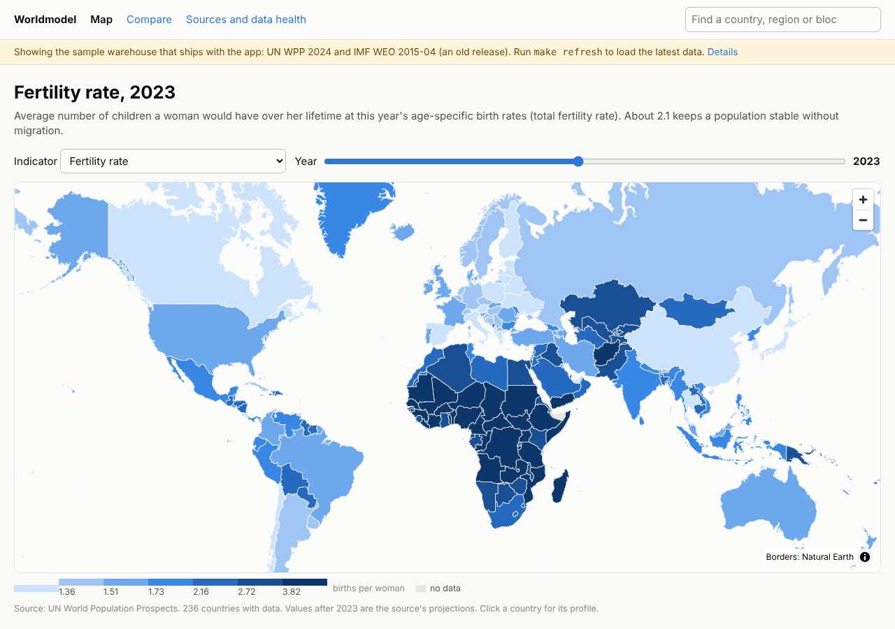

# worldmodel

A personal app for exploring, comparing, mapping and (later) forecasting data
about every country, region and bloc. Everything runs on your own machine.

This is **phase 0**: the foundations, with population (UN World Population
Prospects) and GDP growth (IMF World Economic Outlook) as the first data.



## How it fits together

```
 sources ──► data/ (worldmodel-data CLI) ──► var/warehouse/builds/*.duckdb ──► app/api (FastAPI) ──► app/web (Next.js)
               fetch, keep every vintage,       CURRENT points at the           read-only             map, profiles,
               build with dbt, validate,        live build                                          compare, data health
               swap in only if gates pass                                         ▲
                                                                                  └── other tools: /api/v1/streams, CSV/Parquet/JSON
                          contract/  ◄── both sides depend on this and on nothing of each other:
                                         schema + version, entity crosswalk, indicator catalogue,
                                         sources, named streams, driver graph
```

- **data/** fetches sources, stores each release unchanged as a dated vintage,
  builds the DuckDB warehouse with dbt, runs the validation gates, and only then
  points `var/warehouse/CURRENT` at the new build. Runs headless; no web app needed.
- **app/** is the local API and web app. It reads whichever warehouse it is
  pointed at, never writes to it, and checks the schema version on start. It
  ships with a sample warehouse (`app/sample/`), so it runs with no pipeline.
- **contract/** is the only code both import.

More in [docs/architecture.md](docs/architecture.md).

## Quick start

Needs Python 3.11+ and Node 20+.

```sh
make setup        # virtualenv + Python packages + npm install
make api          # terminal 1: API on http://127.0.0.1:8000 (docs at /docs)
make web          # terminal 2: app on http://localhost:3030
```

The app starts on the bundled sample. To load current data:

```sh
make refresh      # fetch UN WPP 2024 and the latest IMF WEO, build, validate, go live
```

The API notices the new build on its next request; no restart needed.

### On Windows, with conda

Needs [Miniconda or Anaconda](https://docs.conda.io/en/latest/miniconda.html)
and Git. Open an **Anaconda Prompt** (plain Command Prompt won't find conda
unless you ran `conda init cmd.exe`), then:

```bat
git clone https://github.com/Nichevo/worldmodel D:\worldmodel
cd /d D:\worldmodel
setup.bat         :: once: conda env "worldmodel" (Python, Node, Git) + all packages
start.bat         :: API and web app in their own windows, then the browser
```

Your data lives in `var\` inside this folder (set as `WORLDMODEL_HOME` in the
conda environment, so it doesn't depend on where you run commands from). To
load current data: `conda activate worldmodel`, then `worldmodel-data refresh`.

### Updating

Stop the app (close its two windows), then:

```bat
update.bat        :: Windows: latest code from GitHub + any new packages
```
```sh
make update       # macOS / Linux
```

Updates only touch code and packages; `var/` (your downloads and builds) is
never changed. If an update says `environment.yml` changed, run `setup.bat` again.

## The data side

```sh
worldmodel-data fetch un_wpp                  # download a source, store a new vintage
worldmodel-data fetch imf_weo --from DIR      # or load files you downloaded yourself
worldmodel-data build                         # build + validate + swap in
worldmodel-data status                        # vintages, live build, latest report
worldmodel-data validate                      # catalogue checks + gates on the live build
worldmodel-data keys                          # API key register: which keys are set
worldmodel-data export nz-population --format csv
```

Data lives in `./var` (set `WORLDMODEL_HOME` to move it). Back that folder up:
stored vintages are the one thing you cannot download again.

**Validation gates.** A build is swapped in only if every gate passes: dbt
tests (unique keys, every code in the crosswalk, values inside each
indicator's bounds, country populations add up to the UN world total, age
groups add up to the total), at least 200 countries for the core population
indicators and 180 for GDP growth, spot checks against published values, and
no series losing more than 10 percent of its rows. Each build writes a report
to `var/warehouse/reports/` with a random sample of values and links to check
by eye on the source sites. A failed build is kept as `*.failed.duckdb` and
the app keeps reading the previous one.

**Vintages.** Every fetch keeps the source files as downloaded under
`var/raw/`, plus a normalised Parquet copy under `var/vintages/`. A re-fetch
with identical content is skipped; a revised release becomes a new vintage
(`2024+20261105`). The API can answer "as known on a date" from these
(`as_of=` on `/series` and `/streams`).

## Data in this phase

| Source | What | Notes |
| --- | --- | --- |
| UN World Population Prospects 2024 | Population, growth, births, deaths, fertility, life expectancy, median age, migration, population by age and sex (pyramids), age shares, dependency ratio | Estimates to 2023, medium-variant projections to 2100 |
| IMF World Economic Outlook | Real GDP growth, GDP in US dollars and PPP, GDP per person, inflation | Latest release from the DataMapper API; projections about five years ahead |

Regions and blocs are entities with membership over time: the world, UN M49
continents and sub-regions, and EU, euro area, NATO, ASEAN, NAFTA/USMCA,
Mercosur, OPEC, G7, G20 and BRICS. A bloc's value for a year is built from the
members it had that year, with coverage shown. Bloc join and leave dates were
entered by hand and are marked `verified: no` in
`contract/worldmodel_contract/catalogues/memberships.csv` until checked
against the source linked on each row.

**The sample warehouse** holds real UN WPP 2024 data and a real but old IMF
release (April 2015), because the build environment could not reach the UN or
IMF sites. The app says so in a banner. See
[scripts/sample/README.md](scripts/sample/README.md).

## Designed now, built later

- **Ask the data** assistant (phase 3), on Ollama: [docs/design/assistant.md](docs/design/assistant.md)
- **Streams and an MCP server** for other tools such as a Metaculus bot: [docs/design/streams-and-mcp.md](docs/design/streams-and-mcp.md)
- **Linked forecasts**: the driver graph format is fixed in `contract/.../driver_graph.yaml`

## Tests

```sh
make test         # contract checks, the pipeline end to end on fixtures, the API on the sample
make typecheck    # the web app
```

Licences and attributions: [NOTICE.md](NOTICE.md).
